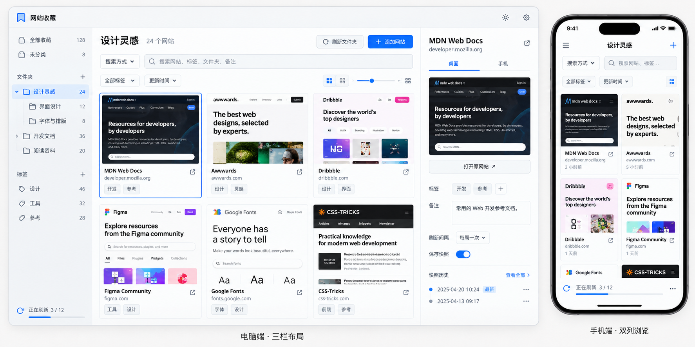

# 前端视觉与交互设计

更新日期：2026-10-09。参考图、视觉方向和主布局已落实至首版界面；具体 token、尺寸、断点及交互见 [前端实施方案](frontend-implementation.md)，实际截图与点击验证见 [实现记录](implementation-status.md)。

## 已确认的视觉参考

用户要求采用下图的布局，并明确指定灰白背景、深色文字，让不同网站的颜色自然显现。原图已原样保存到项目的 `doc/frontend-layout-reference.png`；设计文档继续保存在既有 `docs` 目录。

### 视觉原则

- 应用采用灰白背景、深色文字，呈现克制、稳定的管理工具风格。
- 少量蓝色用于选中状态和主要操作，例如选中文件夹、选中收藏、添加网站。
- 使用细边框、小圆角和轻阴影区分区域与层次。
- 控件规整对齐，保持适中留白；应用图标采用统一风格。
- 网页首屏预览是主要视觉内容，应用外框保持克制。网站本身的颜色自然呈现，不随应用主题重新着色。

### 布局基准

- 电脑采用三栏：左侧为收藏、文件夹和标签导航，中央为搜索、筛选与网站预览网格，右侧为所选收藏的详情和快照。
- 中央区域沿用参考图的信息顺序：当前文件夹与操作、搜索、筛选、收藏卡片。用户已明确首版不实现卡片大小调节，参考图中的大小滑杆不纳入界面。
- “搜索方式”位于搜索框左侧，沿用已确认的复选框多选逻辑。
- 卡片以网页首屏为主体，配合网站名称、域名、必要的标签或更新时间，以及打开原网站入口。
- 右侧详情参考图中的桌面/手机快照切换、打开原网站、标签、备注、刷新间隔、快照开关和历史入口。
- 手机采用双列浏览，上方保留导航入口、当前文件夹、搜索与筛选；刷新进度保持可见。
- 桌面网格按实际可用宽度排布，参考图中的三列作为视觉参照，不将所有电脑固定为三列。

图中的网站、收藏数量、时间和备注作为示例内容，不新增业务规则。手机机身与桌面外框属于展示包装，不需要成为应用内容。右侧“保存快照”开关沿用已确认语义：关闭时保留已有快照和历史。

## 已确认的设计约束

- 产品参考 Eagle 的可视化收藏整理体验，支持电脑和手机。
- 主浏览区域需要同时展示多个网站快照的首屏。
- 网站分别提供桌面和手机快照；访问设备默认显示对应版本。
- 支持多级文件夹、标签、备注和搜索，结果始终为网站收藏。
- 搜索框左侧必须保留“搜索方式”下拉框，通过复选框选择字段。
- 收藏星标为独立按钮，点亮表示已收藏，不导航；点击卡片主体只选中并在当前界面展开详情。使用独立按钮打开原网站。
- 登录只输入密码；有导入、刷新进度、历史查看与清理、级联删除等操作。
- 使用已选轻量前端技术栈；视觉样式采用标准 CSS/CSS Modules。

上述功能约束与已确认视觉参考共同构成界面设计基准。

## 设计决策树

1. 视觉风格 → 字体、色彩、图标、边框、圆角与层次。
2. 主题策略 → 各主题的颜色规则、对比度，以及网页快照与应用背景的关系。
3. 电脑布局 → 导航、搜索、卡片区、详情区的尺寸、折叠与调整行为。
4. 浏览密度 → 卡片尺寸、首屏缩放、文字与标签占比。
5. 手机布局 → 文件夹入口、卡片列数、详情页、返回与编辑操作。
6. 上述方向确定后 → 登录、导入、刷新、历史、设置与删除流程的具体界面；加载、无快照、失败、空结果等状态；键盘与触屏操作。

## 第一轮：原建议与当前确认

| 问题 | 原建议 | 当前确认 |
| --- | --- | --- |
| Q1 视觉风格 | Eagle 式管理工具，网页预览为主体 | 采用用户参考图，强调克制外框、规整对齐与统一图标 |
| Q2 主题 | 浅深双主题 | 已确认灰白背景、深色文字与少量蓝色；此前双主题建议不作为已确认要求 |
| Q3 电脑布局 | 三栏，右侧可收起 | 采用三栏；收起与宽度调整行为待细化 |
| Q4 默认浏览密度 | 中等卡片，可调大小 | 采用卡片式布局，首版不提供大小调节；具体响应式尺寸由设计方案细化 |
| Q5 手机浏览 | 双列，可切单列；抽屉导航与独立详情页 | 采用双列，卡片选中后在当前界面展开详情；具体展开和导航样式待细化 |

原建议中未被用户文字或参考图明确确认的行为继续保留为待细化项。颜色具体值、字体、间距、图标资源及响应式断点尚未定稿。

## 后续交付范围

基于本次已确认参考图，继续细化登录、导入、历史、设置及空白/加载/失败等状态，再记录最终规范：颜色、字体、间距、卡片比例、图标、控件状态和响应式规则。视觉样例只代表应用界面；其中的示例网页内容不构成快照保真的验证。

相关文件：[功能需求](requirements.md)、[技术栈](technical-stack.md)、[访谈记录](design-interview.md)。

## 补充交互确认

- 收藏星标表示页面已收藏，点击收藏不导航；点击卡片主体选中，详情在当前界面展开。此前手机点击收藏进入独立详情页的建议不采用。
- 首版不实现卡片大小滑杆或调节功能。
- 增加 AI 分类方案的人工校对与确认页面，允许修改目标目录，确认后才创建文件夹和归类；待确认网页暂放未分类。
- 搜索范围、标签任一命中、最近添加与当前设备成功快照时间排序已确认。
- 批量整理、旧历史多选清理和删除影响数量展示已确认；布局与操作方式继续细化。

- 取消星标保留网站记录、文件夹归属和快照历史。初始星标默认 false、提供星标筛选，属于本次委托规划的可调整默认。
- AI 配置页面提供接口地址、密钥和模型名称；校对展示原目录参照、目标目录和待创建目录，支持已有分类再次调整。规划采用逐项编辑、勾选批量确认与驳回。
