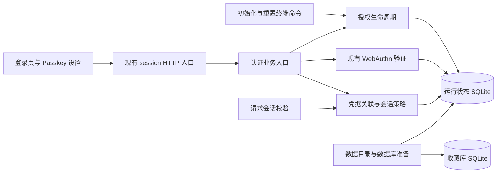
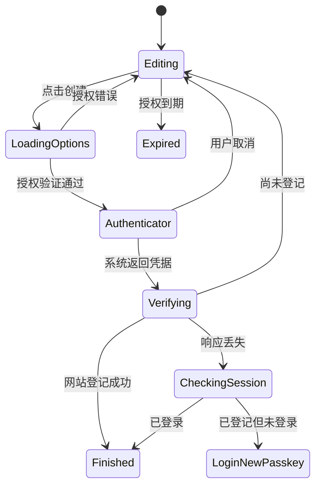

# Passkey 初始化与多设备登录：技术方案

日期：2026-10-17。状态：方案已整理，尚未实施。

后续实施及调整记录见 [入口修复](passkey-first-setup-fix.md)：已有账号无 Passkey 时可直接输入终端码；首次码成功使用前不过期，重启保留；新设备五分钟、重置十分钟。

需求基线：[Issue #4](https://github.com/EiraWalker/Linkarium/issues/4) 与 [Passkey 规格](D:/website/docs/passkey-onboarding-spec.md)。本文件细化实现方式，不重新定义用户流程。

## 1. 总体选择

沿用 Preact、Django、SQLite、Django 数据库会话及已有 WebAuthn 库。新增能力集中在认证模块内部，前端和终端使用同一套授权与注册规则。运行身份仍保存在运行状态库，收藏内容仍保存在独立收藏库。

| 备选方案 | 优点 | 代价 | 选择 |
| --- | --- | --- | --- |
| 在现有认证文件中继续增加条件分支 | 文件变化少，复用直接 | 初始化、授权、会话、协议验证和终端重置交织；入口容易遗漏撤销校验 | 不选 |
| 保留认证入口，拆出授权生命周期及会话策略 | 协议验证继续复用；授权期限、消费、撤销各有明确所有者；HTTP 和终端共用规则 | 增加少量内部模块及迁移 | 采用 |
| 更换认证框架或增加独立账号服务 | 可以采用新的完整账号体系 | 数据迁移与部署范围显著扩大，单用户需求不需要 | 不选 |

不引入 Redis、JWT 登录、独立身份服务或通用仓储框架。现有 `PublicKeyBackend` 的导入路径保留，避免已有 Django 配置和测试出现无关变更。

## 2. 已核对的实现基础

| 当前事实 | 对本方案的影响 | 源码入口 |
| --- | --- | --- |
| 已有 Passkey／文件密钥表，Passkey 支持多条记录 | 增量扩展，不迁移到另一套凭据体系 | [认证模型](D:/website/backend/runtime/models.py:6) |
| 所有者存在才允许获取注册 options | 首次注册必须支持“尚无所有者但有有效终端授权” | [注册 options](D:/website/backend/runtime/authentication.py:103) |
| 所有注册成功都会调用登录并改变认证模式 | 本机添加必须分支为“仅新增凭据”，保留原会话 | [注册与登录完成逻辑](D:/website/backend/runtime/authentication.py:159) |
| 会话仅保存认证类型，没有凭据 ID | 新增统一凭据校验；旧会话升级后重新登录一次 | [会话写入](D:/website/backend/runtime/authentication.py:213) |
| 默认会话期限为 604800 秒，即七天 | 改为十四天，并保存固定的绝对截止时间 | [会话设置](D:/website/backend/config/settings.py:46) |
| 两个 SQLite 连接均配置 `transaction_mode=IMMEDIATE` | 保留配置，通过短事务保证消费、删除与重置的串行提交 | [数据库设置](D:/website/backend/config/settings.py:24) |
| 安装命令将迁移、运行数据准备和所有者创建放在一起 | 拆出不创建所有者的准备步骤 | [初始化命令](D:/website/backend/runtime/management/commands/initialize.py:23) |
| supervisor 启动依赖已建立的运行单例 | 空数据目录准备必须发生在启动 Web／worker 之前 | [监督进程](D:/website/backend/supervisor.py:212) |
| 现有 `/login` 和 `/settings` 路由足够承载流程 | 保留路由，避免扩展整体导航系统 | [路由](D:/website/backend/config/urls.py:5) |
| Compose 未传入 Passkey 外部来源配置 | 补充环境变量传递与部署示例 | [Compose](D:/website/deploy/compose.yaml:21) |

当前依赖锁定为 Django 5.2.18、Python `webauthn` 2.8.0、`@simplewebauthn/browser` 13.3.0、Preact 11.0.1。本功能不要求升级这些版本。

## 3. 模块职责与改动范围

| 模块 | 职责及拟改动 |
| --- | --- |
| `D:\website\backend\runtime\authentication.py` | 保留 `PublicKeyBackend` 和现有认证业务入口；编排注册／登录验证、凭据管理、最后登录方式检查；根据注册用途决定是否建立新会话 |
| 拟新增 `D:\website\backend\runtime\auth_grants.py` | 统一首次、新设备和重置授权的签发、校验、错误计数、期限、用途、原子消费及终端输出所需结果 |
| 拟新增 `D:\website\backend\runtime\auth_sessions.py` | 统一会话凭据关联、绝对期限、认证版本校验及注销规则；中间件和认证业务共用 |
| 拟新增 `D:\website\backend\runtime\bootstrap.py` | 仅负责目录／schema／运行单例准备、首次启动状态判断；不登记登录凭据 |
| `D:\website\backend\runtime\models.py` 与其迁移 | 增加认证状态、授权记录，扩展 challenge 的用途、处理结果及短期重试信息 |
| `D:\website\backend\config\api.py` | 保留统一 JSON envelope，增加有限的认证路由分发；不在路由层复制授权和事务规则 |
| `D:\website\backend\config\middleware.py` 与 settings | 在 Django AuthenticationMiddleware 之后进行统一会话校验；保留现有 CSRF、响应策略及性能中间件 |
| 认证管理命令及 Windows 启动／安装脚本 | 支持无私钥准备；签发首次码；区分终端新增与终端重置 |
| 前端登录、Passkey 设置及认证请求模块 | 共用注册操作；显示首次配置、授权码输入、凭据管理、链接与二维码；处理会话失效 |
| 部署配置、认证文档、OpenAPI 与验收脚本 | 同步新增契约、来源配置、迁移及验收说明 |

`App.tsx` 仅调整注册意图识别与登录后的跳转判断。当前侧栏相关未提交改动不属于本功能，不重写整体应用布局。

## 4. 数据设计

所有下列新数据均位于 `default` 运行状态数据库。保留现有 `PasskeyCredential`、`FileKeyCredential` 和 Django `Session`，不创建跨库关系。

### 4.1 AuthState：认证状态单例

| 字段 | 用途 |
| --- | --- |
| `id=1` | 单一所有者应用的认证状态入口；可在尚无所有者时存在 |
| `credential_epoch` | 认证版本；首次建立身份及终端重置成功时递增，用于拒绝旧会话和旧授权 |
| `webauthn_user_handle` | 认证器中的稳定用户标识；不依赖尚未创建的 Django 用户主键 |

新安装准备阶段生成 32 字节随机 user handle。首次 WebAuthn 注册直接使用它，验证成功后再创建所有者，避免为注册 options 提前创建空账号。

已有所有者的迁移将 user handle 设置为当前实现使用的 `website-owner-{用户主键}` 字节串，保证已有 Passkey 的 `userHandle` 继续通过校验。终端重置保留所有者及该稳定标识，仅替换凭据并递增认证版本。

首次配置是否开放仍以所有者是否存在判断，不能用 Passkey 数量、授权数量或 cookie 判断。

### 4.2 EnrollmentGrant：一次性注册授权

| 字段组 | 拟定内容 |
| --- | --- |
| 身份与用途 | UUID、`purpose=bootstrap/add_device/reset`、可空的目标所有者 ID |
| 来源 | 规范化 `origin`、`rp_id`、签发时 `credential_epoch` |
| 签发者 | `issuer_kind=console/passkey/file_key`、可空的签发凭据 UUID；凭据不存在时授权失效 |
| 秘密验证 | 链接随机标识摘要、独立授权码摘要，不保存原文 |
| 生命周期 | 创建时间、可空截止时间（首次码无截止）、成功消费时间、错误次数、失效时间 |
| 首次码定位 | 可空且唯一的 `active_slot`；仅首次配置使用固定槽位，便于只输入初始化码 |

新设备授权的链接标识使用至少 32 字节随机值；独立码采用规格中的八位数字默认值。码摘要使用应用密钥派生的 HMAC，包含授权 UUID 和用途作域隔离，比较使用恒定时间比较。链接随机值只保存摘要。

首次配置同时只有一个当前终端码。终端手动重新申请替换首次码；重新启动保留已有有效码。首次码成功使用前不过期，不改变新设备授权各自独立五分钟有效的规则。终端重置使用“专用链接＋独立重置码”，与新设备流程复用验证能力但用途不可混用。

失败次数必须在独立的短事务中提交后再返回错误，不能在递增次数后直接抛异常导致整个计数事务回滚。第五次错误使该授权失效。无效链接不创建新的数据库记录；错误响应不返回正确码或签发者资料。

### 4.3 PasskeyChallenge：注册操作与重试记录

保留已有随机 challenge、会话摘要、来源、RP ID、用途及截止时间，增加：

- 可空 `grant`，以及 `registration_mode=local/bootstrap/add_device/reset`。
- 发起时的认证版本、凭据名称及必要的本机会话凭据标识。
- `state=pending/processing/completed/failed`、请求摘要、处理时间。
- 成功后的凭据 UUID 和结果类型，用于辨认重复提交；不存完整认证响应或可恢复的登录 cookie。

challenge 通常三分钟有效，但不得晚于关联授权的截止时间。注册完成后的最小结果记录最多保留十分钟，以覆盖响应丢失重试；它不延长授权，不提供再次登记或登录权限。

旧 `PasskeySetupToken` 和旧 challenge 在升级维护窗口失效。新代码拒绝旧 `setup_token` 单链接协议，终端新增命令改为新授权格式；不同时保留可绕过授权码的旧入口。

### 4.4 会话数据

复用 Django Session 数据，增加以下受服务器签名／数据库保护的内容：

| 字段 | 含义 |
| --- | --- |
| `auth_version` | 新会话结构版本；旧会话缺失则要求重新登录 |
| `auth_mode` | `passkey` 或 `file_key`；调试模式按现有显式配置单独处理 |
| `credential_id` | 登录使用的数据库凭据 UUID，不是用户可任意提交的标识 |
| `credential_epoch` | 登录验证时的认证版本 |
| `authenticated_at` / `auth_expires_at` | 成功登录时间及固定的十四天截止时间 |

调用 `set_expiry(绝对截止时间)`，同时让请求校验检查同一截止时间。不能只设置“修改会话后再过十四天”的相对值，否则 challenge 或其他会话写入可能续期。Django 支持 datetime 到期值，普通 session 写入与 cookie 更新时间需要与此固定策略配合。[Django 会话文档](https://docs.djangoproject.com/en/5.2/topics/http/sessions/)

不新增按物理设备划分的会话表。每次受保护请求检查凭据是否仍存在及认证版本是否一致；因此删除凭据即可拒绝相关旧会话，而无需逐条解码扫描全部 Session。

## 5. HTTP 契约

以下路径均以 `/api/v1` 为前缀，沿用现有 `{data: ...}` 和 `{error: {code, message, request_id}}` 格式。所有变更请求保留 CSRF 和来源验证。

| 方法及路径 | 授权及请求重点 | 结果 |
| --- | --- | --- |
| `GET /session` | 匿名可访问最少状态 | 保留既有字段；增加 `passkey_origin`、Passkey 可用性；登录后可返回当前凭据 ID 和会话截止时间 |
| `POST /session/passkey/grants` | 有效 Passkey／文件密钥会话；用途固定为添加其他设备 | 返回 `enrollment_url`、`authorization_code`、`expires_at`；原文只显示此次，无后续查询接口 |
| `POST /session/passkey/register/options` | 名称＋严格区分的注册授权输入 | 返回 WebAuthn `options`、`challenge_id`、`expires_at` |
| `POST /session/passkey/register/verify` | challenge ID＋系统返回的 credential；关联发起会话与授权 | 返回 `registered`、`authenticated`、本次凭据 ID；本机添加不改变当前登录 |
| `POST /session/passkey/login/options`、`verify` | 沿用现有 Passkey 登录接口 | 新会话记录具体凭据与十四天期限 |
| `POST /session/key/options`、`verify` | 沿用现有浏览器本地文件密钥签名 | 使用相同的会话关联与撤销规则 |
| `GET /session/passkeys` | 已登录所有者 | 返回名称、RP ID、创建／使用时间、是否为当前登录凭据及可删除提示 |
| `PATCH /session/passkeys/{id}` | 已登录所有者，提交新名称 | 返回更新后的记录 |
| `DELETE /session/passkeys/{id}` | 已登录所有者；服务端事务内检查最后登录方式 | 返回删除结果及当前会话是否已退出 |
| `POST /session/logout` | 当前会话 | 沿用现有当前会话注销行为 |

注册 options 的授权输入为互斥的三类：本机操作只提交名称；首次配置提交初始化码；链接操作提交链接随机标识和独立码。服务端从授权记录决定添加或重置用途，不能信任客户端传一个 `reset=true`。同一请求混用本机会话和显式授权时，以经过验证的显式授权流程处理，不能静默降级为本机添加。

授权码验证合并到注册 options 请求，不额外签发一个可以重复复用的“已验证授权码”长期 token。验证成功产生的 challenge 仍绑定原授权，最终提交时再次检查截止时间、消费状态及认证版本。

新增错误包括：`AUTH_GRANT_INVALID`、`AUTH_GRANT_EXPIRED`、`AUTH_GRANT_LOCKED`、`AUTH_GRANT_USED`、`AUTH_ALREADY_INITIALIZED`、`AUTH_LAST_CREDENTIAL`、`AUTH_REVOKED`、`AUTH_ATTEMPT_IN_PROGRESS`。401 继续触发前端 `session-expired`；并发处理返回 409；错误次数超限返回 429。未知链接使用统一无效提示。

凭据列表中的可删除提示仅用于界面，最终决定必须在 DELETE 的事务内重新计算。

## 6. 事务、并发与网络失败

### 6.1 注册的两段提交

1. **领取 challenge**：在短 `IMMEDIATE` 事务中检查会话、来源、用途、时间与状态，将待处理 challenge 原子变成 processing；记录本次请求摘要。重复领取不再进入第二次验证。
2. **协议校验**：退出写事务后执行 WebAuthn 签名、RP ID、origin、用户验证和客户端数据校验，不持有 SQLite 写锁等待任何浏览器交互。
3. **提交业务结果**：再次进入短事务，重新读取授权有效性、认证版本、签发凭据、所有者状态及截止时间；然后登记凭据、执行相应用途的状态变更、消费授权并保存成功结果。
4. **建立会话或返回本机结果**：首次、新设备和重置建立新会话，本机添加保留原会话。会话使用本次已校验的版本，不能重新读取更高版本后把旧校验结果包装成新权限。

注册验证失败使该 challenge 结束，用户可在尚有效的授权下重新取得 challenge。进程在 processing 阶段中断时，不把未完成操作当作成功；可以重新发起注册，旧 challenge 到期后清理。

现有 SQLite `IMMEDIATE` 配置已提供写事务串行化基础。`select_for_update()` 在 SQLite 上没有行锁效果，不能把它写成并发保证；保持事务短小，不新增覆盖整个请求的 `ATOMIC_REQUESTS`。[Django SQLite 文档](https://docs.djangoproject.com/en/5.2/ref/databases/#transactions-behavior)

### 6.2 首次初始化

最终事务内确认无所有者及授权有效，创建禁止密码登录的所有者、登记首个 Passkey、递增认证版本并消费所有首次授权。任何一步失败都回滚身份建立；数据库准备过程可以早于该事务完成。

显式使用私钥的兼容 CLI 若创建了首个所有者，也必须在同一身份提交边界递增认证版本并关闭首次授权，不能留下可再次建立身份的旧初始化码。

### 6.3 删除最后凭据

最终事务内重新校验操作会话仍有效，再统计“当前规范站点可用的其他 Passkey＋有效文件密钥”。满足保留条件后删除目标凭据，其签发的未使用授权随之失效。两个并发删除将依次检查最新状态，不会同时删光凭据。

当前会话使用被删凭据时执行 logout；其他会话在下一次请求中由统一校验拒绝。已经下载的页面或开始传输的内容不能被收回，既有请求不强制中断；后续受保护访问必须失败。

### 6.4 终端重置

在最终事务中创建新 Passkey、删除其他 Passkey 和全部文件密钥登记、递增认证版本、使旧授权及 challenge 失效，并删除全部旧 Django Session。之后为新凭据建立新会话。

当前重置操作只保留已完成的最小结果记录，并标记其完成后的认证版本；该记录不能再作为授权使用。不能在批量失效旧 challenge 时同时丢掉本次响应重试所需的完成结果。

即使旧请求在并发过程中试图写回旧 session，旧认证版本也会使它失效。签发重置入口、开始注册或发生失败均不提前删除旧凭据。两个并发重置按认证版本决定胜者，后提交者不能覆盖第一次成功结果。

### 6.5 响应丢失和幂等结果

当前实现先删除 challenge，且成功登录会轮换 session key，不能直接把现有“消费后重试”当成可恢复。

新方案保留最小完成记录。相同 challenge 和相同请求摘要重试只返回“已登记”的结果，不重复登记、不重新重置，也不凭旧签名发放新会话。不同请求摘要不复用结果。

前端网络恢复后先读取 `/session`：若已登录则继续；若登记已经完成但 Set-Cookie 未收到，则提示使用刚创建的 Passkey 正常登录。此时进行的是新凭据的首次登录，不是用户已排除的管理前复验。禁止仅凭完成记录恢复登录 cookie。

本机添加的响应重试仍需有效所有者会话。新设备授权过期后的完成结果最多提供已完成状态，不能重新获得注册权限。完成记录清理不影响已登记凭据。

## 7. 会话校验的接入

新增 `CredentialSessionMiddleware`，顺序为 Django SessionMiddleware、AuthenticationMiddleware、凭据会话校验，再进入现有视图。有效请求可缓存本次校验结果，避免列表、注册权限等重复读取同一凭据。

对于正常模式的已登录会话，依次检查结构版本、固定截止时间、所有者、认证版本和登录凭据存在性。失败则清理会话并将当前请求视为匿名，由既有接口返回 401；不能只在 `/session` 状态接口检查。

重要认证变更在其写事务内再校验一次操作凭据，防止请求开始校验后恰好发生删除／重置的竞争。

调试密码会话继续只在显式调试模式下可用，但不能获得本机添加或新设备授权权限。终端重置撤销旧调试会话，正常模式不因迁移允许密码登录。

## 8. 前端结构及交互

| 入口 | 计划 |
| --- | --- |
| `D:\website\frontend\src\features\auth\Login.tsx` | 根据首次状态、链接授权意图和普通登录渲染表单，保留私钥文件可选入口 |
| 拟新增 `D:\website\frontend\src\features\auth\PasskeyEnrollment.tsx` | 共用名称／授权码表单与注册状态，避免初始化、新设备和重置各写一套协议流程 |
| 拟新增 `D:\website\frontend\src\features\auth\passkeyClient.ts` | 封装获取 options、调用 SimpleWebAuthn、提交 verify 及错误转换；不拥有服务端权限规则 |
| `D:\website\frontend\src\features\settings\Passkeys.tsx` | 列表、时间、命名／删除、本机添加，以及生成其他设备授权的操作 |
| 拟新增 `D:\website\frontend\src\features\settings\DeviceEnrollment.tsx` | 显示一次性链接、二维码、独立码与五分钟有效时间；不做查询、撤回或后台轮询 |
| `D:\website\frontend\src\api\types.ts` | 定义 session、凭据、签发结果和注册结果类型 |

接收链接采用 `/login#enroll=随机标识`；重置采用可区分的入口片段，由服务端核验真实用途。片段读取后清理地址栏，secret 只在当前页面内存保存。刷新导致内存丢失时，用户可以重新打开原链接；不存入 localStorage 或持久缓存。

二维码拟使用 `qrcode` 在浏览器 canvas 本地绘制，依赖版本实施时锁入 lockfile，不调用远端生成服务。[node-qrcode 官方用法](https://github.com/soldair/node-qrcode#browser)

SimpleWebAuthn 继续采用当前 v13 的 `startRegistration({ optionsJSON })` 与 `startAuthentication({ optionsJSON })`。系统交互由用户按钮触发，避免页面加载或 effect 中自动弹出认证；对移动端实际测试用户手势、取消及错误对象转换。[v13 官方示例](https://github.com/masterkale/simplewebauthn/blob/v13.3.0/example/public/index.html)

发送端倒计时只根据签发返回的截止时间显示，不能暗示新设备是否已完成注册。接收端的最终成功提示属于当前操作结果，不构成被排除的授权状态查询面板。

## 9. 启动、CLI 与访问地址

### 9.1 启动和数据库准备

- 在持有现有 supervisor 实例锁、Web 和 worker 尚未启动时，准备新安装的数据库和运行单例，再恢复维护状态并启动服务。
- 安装脚本和 Windows 部署启动脚本移除“缺少 PrivateKey 必须失败”的检查。未提供私钥时只准备运行环境，不创建所有者；显式提供私钥的旧安装路径可以保留。
- 全新数据目录可以自动准备；首次迁移前，在实例锁内写入不含秘密的准备标记，记录该目录由本版本发起的新安装准备。重启时仅对匹配的未完成准备继续执行，完成后移除标记。目录是否全新按运行库、收藏库及业务内容判定，不能仅依据没有所有者。
- 已有安装若发现未执行迁移，应停止并要求进入维护升级步骤，不能在旧服务仍运行时自动迁移；缺少可信准备标记的半成品目录也走显式准备／修复流程，不猜测是否可以覆盖。
- 应用在当前 RP 无 Passkey 且服务已就绪时，为尚无所有者或已有所有者的首次配置生成终端码；成功使用前不过期，不把码放入公开健康检查或匿名 session 响应。
- 进程重启不延长已签发的新设备授权，并保留已有有效首次码；数据库仅保留摘要，遗失明文时手动运行 `passkey_initialize` 替换旧码。
- schema 已准备但首次操作中断的目录可再次启动。不同数据库的准备不是单个原子事务，准备函数必须幂等并能补齐未完成的单例；身份建立事务仍只涉及运行状态库。直接执行离线准备／迁移命令同样取得实例锁；仅签发授权的在线命令不运行迁移。

### 9.2 管理命令

| 命令职责 | 计划 |
| --- | --- |
| `initialize` | 无私钥可完成数据准备；显式私钥参数保留原登记能力；不把正常准备伪装成已创建所有者 |
| 拟新增 `passkey_initialize` | 仅在无所有者时重新签发首次码，可在线执行，不迁移数据库 |
| `passkey_setup` | 兼容现有“终端新增”用途，但输出新的五分钟链接＋独立授权码；不撤销旧凭据 |
| 拟新增 `passkey_reset` | 仅从终端签发十分钟重置授权，成功绑定后执行全量旧凭据撤销；命令含义与新增明确分开 |

命令的 `origin` 必须匹配规范配置；不把授权码或私钥内容作为命令行参数。输出秘密仅用于本次管理员控制台交付，不写业务请求日志或诊断报告。

### 9.3 规范来源与本机开发

生产使用配置的 `BOOKMARK_PASSKEY_ORIGIN` 作为唯一外部来源和链接生成依据；Compose、环境示例和部署说明补齐该变量。正确配置允许主机、HTTPS、CSRF 来源及可信代理，沿用现有 Waitress 代理信任规则。

Passkey 的 RP ID 是域名，不包括协议与端口；本机开发采用 `http://localhost:实际端口`。不能因某个 loopback IP 能通过安全上下文判断，就认为浏览器会接受它作为 Passkey RP ID。[WebAuthn RP ID 规则](https://www.w3.org/TR/webauthn-3/#rp-id)

因此：绑定监听地址仍可为 127.0.0.1，但本机展示的 Passkey 注册／登录入口使用 localhost；不在未校验的 Host 或转发头上构造邀请链接。现有 IP 地址上的文件密钥登录不因此自动迁移或生成新的 Passkey。

实际公网域名、DNS、证书和部署执行不属于本轮技术规划的操作。实机跨网络验收需另有可用 HTTPS 测试来源。

## 10. 数据迁移与发布顺序

1. 在隔离副本验证迁移。记录迁移前 owner、Passkey、文件密钥及收藏数据的数量／摘要；不输出私钥或完整凭据材料。
2. 正式升级进入维护窗口，停止当前实例管理的 Web 和 worker，保存运行状态库与相关运行配置的恢复点；不在线迁移。
3. 创建 AuthState 和 EnrollmentGrant，扩展 challenge。存在 owner 时回填旧格式 user handle；没有 owner 时生成随机 handle。保持所有已有有效凭据的主键、公钥、签名计数不变。
4. 使旧单链接授权和旧 challenge 失效。旧 Django session 缺少新结构时要求重新登录一次；迁移不删除收藏库内容。
5. 一并部署前后端，避免旧前端向新后端发送过时授权参数。构建完成后重新启动 Web，使静态资源索引对应新产物。
6. 验证 readiness、实际登录页、旧私钥／Passkey 登录及新的会话关联，然后进行隔离新增和撤销验收。

回退必须区分时间点：尚未接受新认证写入时，可停服务恢复本次维护前的匹配版本与恢复点；一旦发生新登记、撤销或重置，不能直接恢复旧运行库，也不能启动不识别新会话／user handle 的旧认证代码，否则可能复活被撤销凭据或拒绝新凭据。此后采用前向修复或保留新认证语义的兼容回退版本。

## 11. 实施顺序与完成门槛

| 阶段 | 交付内容 | 依赖与重点验收 |
| --- | --- | --- |
| P1 数据准备与迁移 | AuthState、授权 schema、稳定 user handle、无私钥数据库准备及旧数据迁移 | A01、A05、A19、A25；验证现有凭据保留 |
| P2 会话与凭据管理 | 绝对十四天期限、凭据关联、统一请求校验、重命名／删除及最后凭据检查 | 依赖 P1；A13–A19；包括两个连接并发删除 |
| P3 注册授权与重置 | 三种授权、独立码、challenge 状态、原子消费、首次 owner 创建、终端重置及失败重试 | 依赖 P1／P2；A02–A04、A09–A12、A20–A24 |
| P4 用户界面 | 首次配置、共用注册流程、本机添加、链接／QR／码、管理列表和错误状态 | 依赖 P2／P3；A06–A08、A13、A15、A26 |
| P5 部署契约与文档 | Windows 和 Compose 来源配置、终端命令说明、OpenAPI、升级与回退文档 | 依赖 P1–P4；安装路径及规范地址完整 |
| P6 综合与实机验收 | 构建、后端回归、隔离浏览器流程、真实电脑／手机／跨网络验收 | A01–A26 全部追踪，实机结果单独记录 |

各阶段是实施和审查顺序，不要求每阶段单独发布不完整功能。合并前必须形成可完成初始化、登录、添加、撤销及恢复的完整路径。

## 12. 验证方法与重点风险

- 以现有认证浏览器验收和认证请求测试为主入口，复用真实签名和虚拟认证器；只模拟时钟、独立浏览器及必要的网络故障，不模拟“服务端验证成功”。
- SQLite 并发测试必须使用临时磁盘数据库和至少两个独立连接／执行线程，覆盖并发初始化、同一授权消费、最后凭据删除、注册与撤销交错。单连接事务测试不能证明这些性质。
- 十四天及五分钟边界用可控时钟验证，在截止前、截止时和截止后检查；不能通过长时间等待或改大超时取代边界断言。
- 对失败计数事务回滚、领取 challenge 后进程中断、最终提交后响应丢失、旧 Session 写回、旧授权跨 epoch 使用建立明确回归场景。
- 首次新安装、已有文件密钥安装、已有 Passkey 安装三类隔离数据均要验证。升级会话重新登录和 user handle 兼容属于必测项。
- 验证删除／重置后的拒绝应访问真实受保护 API 和快照资源，不能只检查列表不再显示旧记录。
- 浏览器验收继续使用构建产物；前端构建和适用的后端认证、迁移、运行状态及既有回归检查通过后，再进行实机验收。
- 现有 `scripts/verify.ps1` 的后端选择仅包含 `library.tests` 和 `tests.portability`，不能以它通过代替认证测试。实施时明确补跑／纳入 `runtime` 及 `library` 测试发现、迁移检查和隔离认证浏览器验收，再执行项目原有发布检查；失败必须保留原始原因，不通过调大超时或跳过用例宣称完成。
- 实机至少覆盖真实电脑认证器、手机扫码添加、另一台电脑复制链接加入及手机另一网络访问。用手机视口或虚拟认证器通过时，实机项仍保持未完成。
- 普通业务日志不写授权材料；不能把仍含请求体的通用异常日志用作认证失败报告。QR 解码验证须证明内容只有链接，没有独立码。

本方案的主要兼容性成本是旧会话升级后需要重新登录一次；主要部署前提是统一 HTTPS 来源；主要正确性风险是多步骤授权的并发提交和成功响应丢失。以上均已进入接口、数据和验收设计，不需要增加用户已经排除的复验弹窗或授权管理面板。

本轮只新增该技术方案文档；实现、数据库迁移、账号重置和部署均未执行。
