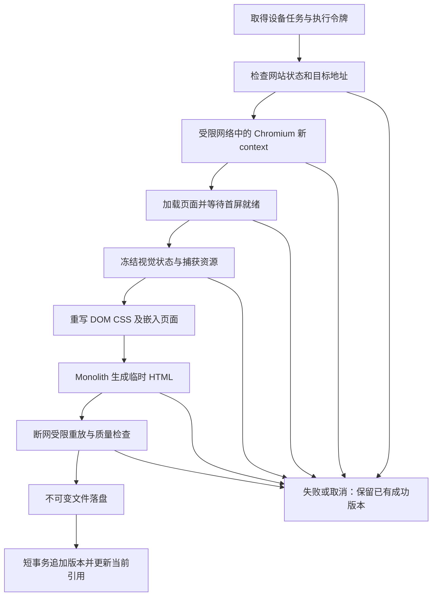

# 动态网页快照流水线与验收方案

日期：2026-10-09。HTML 流水线已实现并完成受控动态页双设备实验；真实公开页兼容和 Linux 完整隔离分别记录于 [实现与验收记录](implementation-status.md)。以[首版需求](requirements.md)与[技术选型](technical-stack.md)为约束；本文的视口、预算和验收阈值是工程默认值，不是对任意网页的兼容性保证。

2026-10-15 实现增补：Windows 开发采集现可显式使用本机 Clash；该可信上游不替代 Linux 网络隔离。样式去重、SVG 内部引用、媒体当前帧／海报／局部占位和验证响应识别已更新，详见 [缓存兼容性与代理](capture-proxy.md)。局部媒体占位保存为带警告的降级归档，不能视为原主视觉完整保真；登录和人机验证仍不保证成功。

## 1. 输出契约与实现顺序

每个启用快照的网站生成独立的 `desktop`、`mobile` HTML 版本。最终归档器使用 Monolith；动态内容在 Chromium 中完成渲染，随后固化为不依赖外站脚本执行的 HTML。2026-10-16 起，默认网格、详情和历史预览使用从该版本离线重放生成的首屏 JPEG 缓存，手机使用自身版本；显式“查看完整快照”继续打开 HTML。详见 [ADR-0010](adr/0010-cached-preview-images.md)，它更新本文早期 iframe 默认展示规则，不改变 HTML 归档与安全检查。

成功版本追加历史并成为该设备的当前版本。某端失败不撤销另一端成功，不覆盖该端最近成功版本。快照关闭后保留已有内容；普通历史清理保留两端各自最新成功版本；删除收藏/文件夹时关联历史全部删除。

为 AI 分类读取标题、简介和有界正文时，元信息任务复用相同的受限 runner 和网络边界。launcher 将 `metadata` 作为固定允许的任务类型，仅返回结构化元信息，不执行 Monolith、不创建 SnapshotVersion；关闭快照不阻止这类元信息读取，且不会因此新增快照历史。

`page.content()` 返回 HTML，不能捕获所有浏览器视觉状态。Monolith 也不执行页面脚本。二者直接串联只是实验基线；状态固化、资源捕获与受限重放必须共同验收。不会把 Monolith 成功退出描述为网页完整还原，也不以 PNG 截图或其他归档器替换已确认的 HTML/Monolith 方案。[Playwright content](https://playwright.dev/python/docs/api/class-page#page-content)、[Monolith](https://github.com/Y2Z/monolith)

先完成该链路的 PoC，再实施批量采集和产品界面。若代表性目标网站无法满足首屏一致性，保留失败证据并明确限制，重新讨论可接受范围；不能自行把一致性目标降为“有内容即可”。

## 2. 单个设备任务的处理步骤



1. 调度器只排入启用快照、未删除的网站。同一网站同一设备只有一个活动采集任务；重复手动操作关联到现有任务，不无限追加。
2. worker 用条件更新认领 Job，在同一短事务内创建 UUID 标识的 JobAttempt，分配单调增加的 attempt_no，并依唯一 `(job_id, attempt_no)` 约束防止重复尝试。记录 lease_token、租约期限、generation、RuntimeState.library_epoch 与 Bookmark.capture_epoch。网络操作在数据库事务外执行。
3. 地址检查通过后建立全新浏览器 context，使用临时空白匿名状态。不得加载用户日常浏览器 profile、应用登录 cookie 或目标站点凭据。桌面与手机各建 context，不共享 cookie/storage。
4. 注册 context 级请求记录、资源预算和路由策略后再导航。拒绝下载、额外页面和权限请求；popup 不纳入采集。Service Worker 默认阻止，受到影响的网站纳入兼容性记录。[网络控制](https://playwright.dev/python/docs/network)、[BrowserContext.route](https://playwright.dev/python/docs/api/class-browsercontext#browser-context-route)
5. 使用 `DOMContentLoaded` 加有上限的首屏就绪检查：字体准备完成、首屏图片完成解码或明确报错、主要可见区域短时稳定。允许站点级等待选择器作为后续调参；不以无限等待或 `networkidle` 作为统一成功条件。[等待状态](https://playwright.dev/python/docs/api/class-page#page-wait-for-load-state)
6. 在有界时间内冻结并读取视觉状态，复制到独立文档中。只触发首屏及邻近区域的懒加载；不自动长距离滚动、不点击登录、验证码、同意购买等控件。弹层保留真实首次匿名访问状态，避免无规则清理造成“看起来更好但不同”。
7. 整理浏览器已取得的资源和各 frame 状态，固化 CSS、图片选择、控件值等，记录缺失清单及其是否影响首屏。
8. 将固化 HTML 通过 stdin 交给 Monolith，保留正确的最终页面 URL 作为相对地址基准。用进程参数数组调用，不拼接 shell 命令，不允许用户提供任意 CLI 参数。
9. 在无外部网络访问、与产品相同 sandbox/CSP 的条件下重新打开临时 HTML。检查可读性、首屏核心内容、资源缺失、嵌入页和是否产生被拒绝的外连。自动检查不能替代 PoC 的人工视觉对照。
10. 输出通过检查后计算 SHA-256，写入不可变归档目录；最终提交前再次检查收藏存在、快照仍开启、Bookmark.capture_epoch、JobAttempt UUID、lease_token、租约、generation 与 RuntimeState.library_epoch。条件不符即丢弃结果，不更新当前快照。

## 3. 桌面和手机采集配置

| 参数 | 桌面初始值 | 手机初始值 |
| --- | --- | --- |
| CSS viewport | 1366 × 768 | 390 × 844 |
| device scale factor | 1 | 2 |
| mobile / touch | false / false | true / true |
| 浏览器 | 锁定版本的 Chromium | 同一版本 Chromium 的移动设备模拟 |
| UA | 与 Chromium 版本匹配的桌面配置 | 从同版本 Playwright 的 Android 手机设备配置派生，覆盖视口 |
| locale / timezone | `zh-CN` / `Asia/Taipei` | 同左 |
| color scheme | light | light |
| 首次访问状态 | 无目标站登录、无历史存储、页面顶部 | 同左 |

以上模拟定义可重复比较的基准，不能等同于某位用户已有 cookie、IP 地域或 Safari 渲染下的个性化页面。保留网站自身颜色；`light` 只固定系统偏好，不强制改写深色网站。采集配置存版本号，变更后应用于新快照，旧版按原视口重放。设备模拟选项由 Playwright 提供，真实手机 Safari 的重放兼容仍需验收。[设备模拟](https://playwright.dev/python/docs/emulation)

静态 HTML 的媒体查询还可能依赖设备像素比、触摸能力和系统色彩，而非仅 iframe 宽度。因此需要记录采集环境，并在 CSS 固化实验中检查相关媒体规则；不能声称“iframe 宽度正确”就足以复现桌面/手机状态。

## 4. 浏览器资源捕获与 Monolith 二次取资源

### 4.1 选定主路径：尽量使用本次浏览器已取得的字节

记录 response 的原始 URL、最终 URL、MIME、状态、编码、资源所属 frame 和响应字节，按大小预算保存到临时工作区。首屏图片以 `currentSrc` 所指内容固化；CSS 需解析 `url()`、`@import` 和字体引用，再递归替换为内联资源。SVG 的外部引用、CSS 伪元素背景、`picture/srcset`、`blob:` URL 也必须进入资源清单。

改写基准按资源自身最终 URL 计算，不能把所有 CSS 相对路径都按页面 URL 解析。保留 MIME、字体格式和编码；资源以内容哈希去重。先解析再改写，禁止使用字符串替换去处理 HTML/CSS 嵌套结构。

预处理选用 html5lib 做离线 HTML 树解析/序列化、tinycss2 做 CSS token/块解析；浏览器侧负责取得实时 DOM 和状态。tinycss2 只理解语法，不自动理解所有 CSS 属性的资源语义，因此 URLToken、url()、@import、嵌套块及新语法仍需明确遍历和 fixture 验证。html5lib 的解析/序列化也可能改变结构，需要覆盖 SVG/template/shadow DOM 等回归样本；解析器不是安全净化保证，执行与出网边界仍由独立策略约束。两者已通过 Context7 核验解析能力。[html5lib](https://github.com/html5lib/html5lib-python)、[tinycss2](https://github.com/Kozea/tinycss2)

浏览器可能没有加载首屏外资源；流式响应、缓存/Service Worker 路径、跨 frame 状态和 blob 资源也可能无法简单取得。缺失必须可观测，不能把拿不到的内容转换为空字节后宣布成功。

### 4.2 Monolith 调用与补取策略

候选参数为 `-j -M -b <最终页面URL> -o <临时输出路径> -`，以 stdin 输入已固化文档；具体参数按实现时锁定的发布版 `--help` 与 fixture 核验。`-j` 在动态状态固化后移除脚本；不使用 `-f` 全局删除 iframe，不使用 `-k` 关闭 TLS 校验，不默认使用忽略网络错误选项。[Monolith CLI](https://github.com/Y2Z/monolith#options)

主路径在 Monolith 阶段禁止外部网络，所有应显示资源在此前阶段准备好。若遗漏资源导致失败，回到资源准备阶段有界补取，再重新归档。确有必要让 Monolith 补取时，必须放入与 Chromium 同等网络限制的执行环境，继续受总字节、时间和地址限制；防火墙策略缺失或旁路检测失败时终止。环境中的 HTTP/HTTPS 代理变量默认清空；如后续部署采用代理，它也不能代替隔离。[Monolith 代理环境支持](https://github.com/Y2Z/monolith#proxies)

补取未必与浏览器看到的资源相同：UA、匿名 session、Referer、有效期和服务器响应变化都可能造成差异。优先复用本次浏览器响应，补取资源标记来源并重新验证视觉状态。临时匿名 cookie 如确需用于补取，仅保存在任务私有工作区、限定原域名和生命周期，完成后销毁。

Monolith 的远程资源读取包含 CSS/frames 的递归下载，其源码中可见整段响应字节读取；最终输出大小检查并不能限制下载过程和内存峰值。外层进程与网络预算是必须实现的控制。[固定版本网络源码](https://github.com/Y2Z/monolith/blob/v2.11.1/src/net.rs)

## 5. 视觉状态固化清单

| 浏览器状态 | 计划处理 | 必须验证的边界 |
| --- | --- | --- |
| JavaScript 生成的普通 DOM | 读取渲染后树并去除执行能力 | hydration 状态是否只在运行时对象中、页面是否仍在变化 |
| input/textarea/select/details | 把当前值、选中、展开状态写回副本文档 | 控件浏览器原生样式差异；不保存密码类字段 |
| CSSOM / 动态样式 | 提取可读规则及 adoptedStyleSheets，保留顺序、作用域、媒体条件 | 跨域 cssRules 拒绝访问、动态 insertRule、伪元素与字体回退 |
| 动画/过渡 | 在选定采集时刻冻结，并固化可表达的计算样式 | 直接删除 animation 可能回到初始帧；不能一概这样做 |
| canvas / WebGL | 可读取时将当前位图以内嵌资源保存在 HTML 对应位置 | 污染画布、WebGL 缓冲失效、OffscreenCanvas；不能保证全部可读 |
| video | 优先保留海报；如首屏显示当前视频帧，实验验证其帧固化 | DRM、跨域媒体和流式媒体不能保证，失去主视觉时为失败 |
| open shadow DOM | 提取可访问树与样式，评估 declarative shadow DOM 或经过验证的静态展开 | slots、样式封装、Monolith 是否保留声明式结构、各客户端解析差异 |
| closed shadow DOM | 利用能明确取得的 serializable 状态或句柄 | 普通 DOM 读取不可假定能够取得任意 closed root；缺失不可隐瞒 |
| iframe | 逐 frame 固化可取得的状态及资源，嵌入受限静态子文档 | 跨域、嵌套、子页导航、内部视口、拒绝嵌入页与嵌入 CSP |
| 媒体查询 / 固定定位 / 视口单位 | 按采集视口重放；固化必要的环境依赖 | 不同终端 DPR、hover/pointer、vh/dvh 与系统字体造成差异 |

画布位图作为 HTML 内部资源不改变 HTML 归档格式，也不意味着整页改成截图。是否需要采用该处理由 PoC 证明；无法读取的状态要报告限制。Canvas 的跨来源污染会阻止导出；`getHTML()` 的 shadow roots 选项也不意味着自动取得所有关闭的树。[Canvas 导出](https://developer.mozilla.org/en-US/docs/Web/API/HTMLCanvasElement/toDataURL)、[Shadow DOM 序列化](https://developer.mozilla.org/en-US/docs/Web/API/Element/getHTML)

先以首屏可见元素作为严格保真范围；归档可保存已加载的整页 DOM，但不承诺无限滚动后的未加载页面。用户当前要求“展示首屏”，不需要为整个网站无限递归抓取。

## 6. 受限 HTML 重放

快照文件置于私有目录，通过检查 owner 会话的 Django 端点提供。直接打开同一端点也应用强制 CSP sandbox，不能只依赖前端 iframe 的属性。响应使用 `text/html; charset=utf-8`、`X-Content-Type-Options: nosniff`、`Referrer-Policy: no-referrer` 和私有缓存策略。

外层 iframe 采用空 `sandbox`，不授予 `allow-scripts`、`allow-same-origin`、表单、弹窗或顶层导航权限。候选响应 CSP：

```text
sandbox;
default-src 'none';
script-src 'none';
connect-src 'none';
style-src 'unsafe-inline' data:;
img-src data:;
font-src data:;
media-src data:;
frame-src data:;
object-src 'none';
base-uri 'none';
form-action 'none';
frame-ancestors 'self';
```

嵌套静态 frame 使用经过同样净化的 data 文档或经 PoC 验证的 srcdoc。必须验证继承的 sandbox/CSP，不能以允许 frames 为由放开 `http:`、`https:` 或脚本。清理脚本、事件属性、meta refresh、表单动作、外站导航目标、危险 URL 协议、外部 object/embed 和残留外链。CSP/sandbox 是执行边界，净化降低遗漏风险；二者都不能独立证明保真。CSP `sandbox` 必须置于 HTTP 响应头，不能只写 meta。[CSP sandbox](https://developer.mozilla.org/en-US/docs/Web/HTTP/Reference/Headers/Content-Security-Policy/sandbox)

网格里的 iframe 不接收交互点击；点击由应用卡片层处理为选中。打开原网站使用应用提供的独立按钮。iframe 采用采集宽高作为内部画布，外部 `transform: scale()` 与裁剪只影响显示尺寸。视区之外卸载；不能靠 `loading=lazy` 控制已经加载页面的内存。

安全净化和状态固化可能改变布局，这些处理后的最终产物才是视觉验收对象；不能拿净化前的 HTML 对比后宣称产品预览一致。

## 7. 采集网络边界：防止 SSRF 与 DNS rebinding

### 7.1 地址校验覆盖所有阶段

主 URL、每次重定向、iframe、图片、CSS、字体、XHR/fetch、WebSocket 和 Monolith 补取都视为不可信出站请求。书签目标仅允许 HTTP/HTTPS；默认仅 80/443 端口，拒绝内嵌用户名密码和其他协议。入参 URL 解析、IDNA 与 IPv4/IPv6 表示统一后再判断。

拒绝环回、私有、链路本地、组播、未指定、保留和云元数据地址，并显式处理 IPv4-mapped IPv6、整数/缩写 IP、localhost 类域名、混合公私 DNS 响应与自有应用地址。不能只用域名后缀或一条正则；地址范围规则要有 fixture 和当前标准数据。数据 URI 仅在类型、深度、大小检查后作为内嵌资源使用。

URL 入库前校验和 Playwright 路由校验是早期反馈，不是最终网络边界。请求校验后再由另一个网络栈重新解析域名仍会产生 rebinding 窗口。route 在 Service Worker、弹窗/重定向等情形有边界，Monolith 也不经过 Playwright 路由。[Playwright route](https://playwright.dev/python/docs/api/class-page#page-route)、[OWASP SSRF 防护](https://cheatsheetseries.owasp.org/cheatsheets/Server_Side_Request_Forgery_Prevention_Cheat_Sheet.html)

### 7.2 可实施的强制出站路径

首版选定 Linux network namespace/受限容器加 nftables，直接按实际网络包目的 IP 限制访问，不引入常驻代理。与“先解析检查、再任意联网”不同，DNS 随后解析到私网也会被内核阻止。这降低新增依赖，但要求部署时确实能配置并验证相应内核规则。

1. Chromium/Monolith 位于独立采集环境，不共享宿主网络；只获得任务输入和私有临时输出目录，不挂载 Docker socket、数据库、应用密钥或宿主用户目录。Playwright 控制采用进程管道，不给采集网页开放宿主调试端口。
2. 在采集 network namespace 的 `output` hook 安装 `policy drop` 的过滤链；只有目的地址属于准许的公网 IPv4 且 TCP 端口为 80/443 才放行。返回包按已建立连接放行，拒绝新入站；规则不按 Chromium 单一 PID 匹配，覆盖 Monolith、浏览器子进程和其他派生进程。
3. 目的地址集合由维护的特殊地址表、部署网络信息和自有应用地址产生：拒绝私有、回环、链路本地、CGNAT、组播、保留等非公开段，额外拒绝本机/应用公网 IP、VPC、宿主接口地址和供应商特殊服务地址。首版整体禁用采集网络 IPv6，同时拒绝 IPv6 流量，IPv6-only 目标明确报告暂不支持。[IANA 特殊地址表](https://www.iana.org/assignments/iana-ipv4-special-registry/)
4. DNS 只允许到部署时指定的公共解析器固定 IP 的 UDP/TCP 53；不允许采集进程任意访问内网 DNS/其他 UDP 服务。HTTPS 保持 hostname/SNI 和证书验证。URL 预检仍检查全部解析结果并拒绝混合公私响应，但最终防护由实际目的 IP 过滤完成。
5. 宿主针对采集虚拟接口的 `input/forward` 再施加范围限定规则，确保 DNAT/端口映射、宿主网关与桥接转发不能把允许的公网目的变成内网访问。明确 filter hook/优先级，不能在只处理首包的 NAT 链里充当过滤器，也不能依赖 Docker 默认规则。规则仅作用于采集接口，不修改用户其余网络的默认策略。[nftables chains](https://wiki.nftables.org/wiki-nftables/index.php/Configuring_chains)、[sets](https://wiki.nftables.org/wiki-nftables/index.php/Sets)、[Docker 防火墙](https://docs.docker.com/engine/network/packet-filtering-firewalls/)
6. 规则由受信任的启动器预先装载、验证后再运行低权限采集；采集进程无 `CAP_NET_ADMIN`，不能修改规则。明确测试 DNS rebinding、直连 IP、重定向、QUIC、WebRTC/STUN、代理环境变量、子进程与 IPv6 不得绕过限制。初始化失败时拒绝开启采集，不退回无限制模式。
7. Monolith 主路径在完全断网的归档阶段运行；补取必须回到同等限制的采集网络。任务传输字节、连接数和时限由 network namespace 计数与进程监督器约束，解压后的资源字节和内存另有上限。`file:` 等本地资源只可能接触隔离文件系统中的任务文件与最小运行时；不得暴露任何应用秘密。

普通 Docker bridge 默认能联网，不满足以上规则。以非 root 用户运行 Chromium，保留 Chromium sandbox 和合适的 seccomp/资源限制；不把 `--no-sandbox` 当成部署办法。Playwright 官方通用镜像文档也没有承诺镜像本身足以安全抓取不可信网站。[Docker 网络](https://docs.docker.com/engine/network/)、[Playwright 容器说明](https://playwright.dev/python/docs/docker)

部署阶段由受控宿主启动器预置网络、mount/PID/user 隔离与 cgroup 预算。非 root Web/worker 不自行假定能执行 `unshare/setns`，也不获得全局 `NET_ADMIN`、`SYS_ADMIN` 或 privileged 容器。启动器的启动、cancel、status 与退出确认均使用受格式校验的 `(attempt_uuid, generation, library_epoch)`，不接受只有 Job ID 的进程控制指令。固定 spool 根下采用 `<generation>/<library_epoch>/<attempt_uuid>/` 映射只读输入和输出；重试必须取得新 UUID，旧尝试的迟到 cancel 只能命中旧 cgroup，不得终止同一 Job 的新尝试。不接受任意 shell 命令、可执行程序或宿主路径。调用接口仅通过本机文件权限限定的 socket 暴露，拒绝符号链接/路径逃逸，运行镜像和入口固定。URL 位于任务输入中，由低权限采集程序读取。此启动器属于必须实现并验收的部署组件；不能把普通 Compose 启动成功当作隔离已经成立。具体安装、启动和恢复由[运维与安全方案](operations-security.md)统一定义。

受限 HTTP/CONNECT 代理是未来其他部署环境的替代实现选项；它必须固定已校验的数字目标 IP，并且采集网络只能到代理，否则仍可旁路。首版不实现、部署该额外代理，避免同时维护两套出站边界。

Windows 本地部署仍可保留原生 Web/API。如果原生采集进程树的 WFP/防火墙、用户隔离和资源约束无法通过相同测试，完整采集使用本机 Linux 容器或 WSL2 中的受限执行环境。需要配套文件交接与进程生命周期管理；这是部署实现门槛，不等于当前已经验证 Windows 原生具有该能力。不得通过取消地址限制来换取原生运行。

## 8. 文件发布、并发和恢复

每个设备任务的每次 JobAttempt 拥有唯一工作目录与执行令牌，身份为 `(attempt_uuid, generation, library_epoch)`。临时输入/资源不会被快照 API 暴露；完成后销毁。HTML 以 SHA-256 内容地址写入当前库代际目录下的 `artifacts/<prefix>/<hash>.html`，其中 prefix 为哈希前两位；历史记录保存采集时间、设备、配置版本、最终 URL、文件字节数、哈希与质量摘要。业务任务和快照记录在 `library.sqlite3`，运行身份与活动库代际在 `state.sqlite3`；两库不建立跨库外键。字段与约束以[数据模型](data-model.md)为准，本文只定义流水线使用方式。

发布顺序：事务外完整写入并刷新临时文件 → 数据库 IMMEDIATE 写事务再次验证尝试、任务和网站条件 → 持写锁原子重命名为不可变文件或校验复用已有文件 → 同一事务内插入/复用 Artifact、插入 SnapshotVersion、更新该设备当前引用、标记 JobAttempt 与 Job 成功 → 提交。清理持有相同写锁，避免文件发布与引用创建之间的孤儿回收竞态。SnapshotVersion.capture_attempt_id 唯一，作为同一尝试重复提交的数据库屏障。重复提交已成功的 attempt 时返回既有结果；相同字节的不同成功 attempt 复用 Artifact，但保留各自历史记录。

数据库提交前失败可能留下无人引用的完整文件，后台在宽限期后清理；提交后进程退出应能通过唯一 capture_attempt_id 及已提交的尝试/任务状态识别已完成，不重复创建历史。归档文件先存在再提交引用，可避免正常发布产生悬空引用，但文件系统/数据库不是跨系统原子事务，仍需启动完整性检查。

任务租约过期后先按旧 `(attempt_uuid, generation, library_epoch)` 取消采集并确认对应 cgroup 全部进程退出，再以新 JobAttempt UUID 和新 lease_token 重试；旧进程的迟到结果不得提交。恢复备份先由控制器停止并等待 Web/worker 全部子进程，同时按具体尝试身份取消宿主启动器中的采集并确认 cgroup 退出，然后构建新的库目录，由 `state.sqlite3` 的 active_generation/library_epoch 事务切换，重启后开放服务。结果携带 generation、library_epoch、attempt_uuid、lease_token 和 Bookmark.capture_epoch；两库检查并非天然原子，维护停机与锁负责阻止恢复窗口中的旧尝试发布。删除收藏/关闭快照/修改 URL 均使旧采集条件检查失败。清理文件仅删除无任何历史引用、无活动尝试占用且过了宽限期的对象。普通删除与恢复期间的维护锁必须与后台清理协调，详见运维方案。

自动重试只覆盖短暂 DNS/网络中断、超时、浏览器意外退出等，初始最多额外两次，间隔 1 分钟和 5 分钟并加少量抖动。地址策略拒绝、需登录/验证码、明确不支持的视觉状态、超资源预算先记录错误，不立即重复。手动刷新可主动再次尝试；失败原因与上次成功时间分别展示。

新任务不使旧预览消失。状态区分排队、抓取、归档、验证、成功、失败、跳过/取消；前端批次进度按设备任务计数，并同时给出网站数量，避免“两端之一成功”显示整站完全成功。

## 9. 初始预算与容量估算

这些值供第一轮测量使用。超过预算时中止该次任务、保留旧快照并给出具体错误；不静默发布残缺首屏。

| 项目 | 初始工程预算 |
| --- | --- |
| 同时采集 | 一个设备页面；桌面和手机顺序执行 |
| 浏览器复用 | 每批最多 20 个设备任务或 10 分钟；空闲 30 秒释放 |
| 单设备总时限 | 120 秒，覆盖导航、等待、固化、归档、验证 |
| 导航 / 首屏稳定 / Monolith | 分别最多 30 / 10 / 30 秒，且受总时限约束 |
| 每设备网络资源数 | 300 个；嵌套 frame 深度 3、总 frame 数 10 |
| 单资源 / 资源累计 | 16 MiB / 96 MiB 的捕获字节预算；开发代理总传输预算为 96 MiB |
| 最终 HTML | 96 MiB 默认与硬上限；发布、备份与恢复使用相同限制 |
| 临时工作目录 | Linux 输出 tmpfs 每设备 384 MiB，私有 `/tmp` 256 MiB；流水线阶段结束及时释放 |
| 采集进程组内存 | 第一轮按 1.5 GiB 硬预算实验，记录触顶网站；非硬件最低要求 |
| Monolith 子进程内存 | 第一轮 512 MiB 子预算，仍受进程组总预算约束 |
| 任务心跳 / 租约 | 10 秒 / 180 秒；持续心跳续约，总时限不随心跳无限延长 |
| 可用磁盘保护 | 低于 1 GiB 或预计本任务/备份空间不足则暂停新增归档并提示 |

默认只保留首屏必需资源的高优先级；如果总预算不足以取得这些资源，则任务失败。对无关首屏外资源的省略仍需记录范围，不能隐藏首屏缺失。浏览器、HTML 解析器、字体与解码后的图片内存不等于网络字节数，因此必须对实际进程树施加操作系统级限制并测量峰值。

保存全部历史意味着容量持续增长。仅作算术示例：每个设备版本平均 2 MiB、1000 个网站、每周刷新一次，则每轮约 3.9 GiB，一年 52 轮约 203 GiB，未计备份/临时文件；这不是实测平均值。界面显示当前用量与最近版本平均大小，提供手动清理，不按容量偷偷淘汰历史。

单设备若平均耗时 30 秒，2000 个设备任务串行约 16.7 小时；这是估算公式示例，不能承诺一次千站刷新需多久。PoC 后用实际 p50/p95 耗时给部署建议，先保留低并发与错开到期，避免同时启动上千浏览器页。

## 10. PoC 与验收门槛

建立两组样本：可控 fixture 和用户实际有代表性的公开网站。第一批至少覆盖 12 类页面，每类都采集两种设备：静态文章、CSR 内容、CSS-in-JS、懒加载图、webfont、srcset/picture、canvas、WebGL/视频、open/closed shadow DOM、同源/跨域 iframe、固定/粘性布局、重定向/临时资源 URL。遇到登录或反爬页面单列结果，不能冒充成功内容。

| 验证项 | 通过条件 |
| --- | --- |
| 首屏内容 | 标题、主图、关键正文、导航等关键区域不丢失；不以登录墙/错误页冒充成功 |
| 布局与样式 | 与同一采集配置下、同一采集时刻的浏览器首屏逐项对照；字体、图片比例、主布局和颜色无明显偏差 |
| 动态状态 | 各 fixture 的运行后状态进入最终 HTML；已知不可固化状态被准确报告 |
| 双端 | 手机确实执行移动配置并产生相应内容/布局；每端时间与失败互相独立 |
| 断网重放 | 最终产物在产品 CSP/sandbox 下可显示，不需要外站请求补齐首屏 |
| 安全隔离 | 内网/元数据/IPv6/重定向/rebinding/环境变量旁路 fixture 全部受阻；强制网络策略不可用时关闭采集 |
| 产物访问 | 未登录不能读取；直接打开归档端点仍不能执行脚本或读取应用会话 |
| 故障恢复 | 进程被杀、磁盘满、DB 忙、删除/停用/恢复同时发生时，不覆盖旧成功版、不复活已删收藏 |
| 资源控制 | 超限能停止全进程树并释放临时文件；手机网格多 iframe 的内存另由前端验收 |

对照图或像素差异图仅可作为测试证据，不作为产品快照、存储回退或前端卡片资源。图像差异度量用于定位偏差，字体抗锯齿等必须结合人工检查；不能只用一个相似度数字决定“与浏览器一致”。此规划阶段没有抓取真实页面或生成上述对照图。

PoC 交付记录每个样本的 URL/fixture、日期、浏览器/Monolith/采集配置版本、两端 HTML、缺失清单、首屏对照结果、耗时/内存/大小及失败原因。任一关键样本未满足目标时，在问题清单中保留，不能用总体成功率掩盖。

## 11. 信息来源与尚未证明的能力

2026-10-09 已通过 Context7 resolve/query 核查 Playwright Python 的 content、route、emulation、等待状态及 nftables 的过滤链/set 文档。Context7 未返回匹配的 Y2Z/monolith，因此使用项目官方 README 和 v2.11.1 源码补充。网络隔离、状态转换、资源重写与验收流程是本项目设计，不是库自带的完整能力。

本文件不证明：所有动态网页可无损归档、全部视频/canvas/closed shadow DOM 可提取、手机 Safari 与 Chromium 完全一致、Windows 原生网络隔离已完成，或上述预算足够覆盖实际收藏。这些均由实现和验收证据决定。
