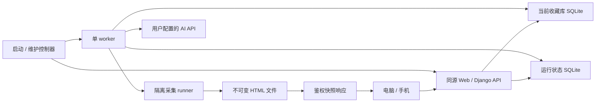

# 网站收藏管理：完整技术方案

日期：2026-10-09。本文件保留技术设计基线；首版应用已实现，实际版本、验证及尚未通过的部署条件见 [实现与验收记录](implementation-status.md)。

本方案依据 [已确认需求](requirements.md) 和 [视觉参考](../doc/frontend-layout-reference.png)。用户已授权从需求访谈转入完整技术规划；下文工程默认值用于使方案具体可实施，可在原型评审后调整，不冒充逐项确认的产品要求。

## 1. 目标与首版边界

个人使用、电脑和手机联网访问同一后端，以网站卡片组织最多约一千条收藏的首版验收场景。保存公开网页的桌面与手机 HTML 快照，提供历史、搜索、目录标签、AI 分类校对、批量整理和整库备份恢复。

首版按已选方案提供密码登录、每周/单站定时刷新及文件夹递归刷新。卡片星标与选中独立，取消星标保留数据；电脑详情在右栏，手机详情在当前页面展开。手动删除收藏/文件夹级联删除历史；普通历史清理保留每种设备的最新成功版本。

### 规划默认值

| 编号 | 工程默认 | 依据与调整范围 |
| --- | --- | --- |
| D1 | 新增/导入网站 `is_starred=false`；可筛选全部或星标 | 上轮推荐未单独回答，现作为可调整的界面默认，不影响收藏记录是否保存 |
| D2 | 新增网页自动生成分类建议；已有网页通过主动操作重分类 | 已有分类可再次调整；定时刷新只更新快照，避免周期性制造待审建议 |
| D3 | 分类校对支持逐项修改、勾选批量确认和驳回 | 确认前不创建目录、不移动网站；驳回不删除网站 |
| D4 | 手机详情用同页底部弹层 | 可上拉、关闭后保持网格位置；电脑右栏首版固定宽度并可收起 |
| D5 | AI 未配置或失败时仍可新增、导入、查看和手工整理 | 分类能力降级不阻塞收藏库及快照功能 |

## 2. 技术栈与运行形态

| 部分 | 选型 | 职责 |
| --- | --- | --- |
| 浏览器前端 | Preact + TypeScript + Vite + CSS Modules | 响应式卡片、目录与详情、分类校对、任务与配置 |
| 业务 API | Python 3.13 + Django 5.2 LTS 原生 JSON views/forms | 校验、认证、事务、查询和任务登记 |
| 登录 | Django auth/session + django-axes | 内部固定 owner；前端只输入密码 |
| 本地存储 | SQLite；业务与运行状态各一份文件 | 无独立数据库服务；恢复收藏库不回滚密码与 API 凭据 |
| 后台任务 | 一个低并发 Django management command worker | 元信息、快照、AI、导入、清理及重试 |
| 网页采集 | Playwright Python + Chromium + Monolith CLI | 浏览器执行动态网页，再固化为 HTML 归档 |
| 文档资源改写 | html5lib + tinycss2 | HTML 树与 CSS token 解析/序列化；不使用正则代替语法解析 |
| AI 传输 | HTTPX 同步客户端 + 薄协议适配层 | 首版支持 OpenAI 风格 Chat Completions 协议，具体服务需兼容性验证 |
| Web 服务 | Waitress + WhiteNoise | 前者运行 Django；后者只服务前端构建文件 |
| 生命周期 | Python 标准库实现的薄父进程 | 守护 Web/worker；从运行库领取备份/恢复等维护操作，停机切库后重启 |

前端构建后是静态文件，生产不需要 Node 服务。首版不引入独立消息队列、搜索服务或外部数据库。当前实现每次采集启动并关闭浏览器，以独立尝试和取消边界优先；跨任务复用浏览器留待测量后优化。

原先的一份 SQLite 调整为同机两份 SQLite：`state.sqlite3` 保存身份、会话、凭据和维护状态；`library.sqlite3` 保存可备份的业务内容。这是为覆盖恢复建立边界的技术细化，见 [ADR-0007](adr/0007-runtime-and-library-state.md)。

Python/前端依赖已由 `uv.lock` / `frontend/package-lock.json` 锁定，Chromium revision 与 Monolith 二进制由安装脚本固定。实际安装版本见 [实现记录](implementation-status.md)；本文引用源码版本不等同于本机二进制版本。

## 3. 结构与模块边界

代码已位于 `frontend/`、`backend/`、`deploy/`、`scripts/` 和 `tests/`，文档与参考图保存在 `docs/` 和 `doc/`。实际模块以源码与 [实现记录](implementation-status.md) 为准。

| 后端模块 | 对外职责 | 保持在模块内的规则 |
| --- | --- | --- |
| identity | 登录、退出、密码维护、会话校验 | 固定 owner、CSRF、限流和运行凭据 |
| catalog | 网站/目录/标签/星标/搜索/批量编辑 | URL 去重、目录无环、单一归属、乐观并发 |
| archive | 元信息采集、快照与历史读取/清理 | 双设备状态、不可变文件、最新成功指针 |
| classification | AI 候选、校对、接受/驳回 | 输入裁剪、目录白名单、过期方案校验 |
| jobs | 入队、认领、重试、进度与取消 | 单 worker、租约和结果失效判断 |
| portability | 导入预检、备份导出、覆盖恢复 | 原目录参照、重复跳过、完整性与维护窗口 |

视图仅做身份检查、输入校验、调用模块服务和响应转换。领域服务拥有事务；浏览器、Monolith、AI 请求在事务外执行。不同模块通过明确服务调用合作，首版不建通用事件总线。

## 4. 持久化与事务

详细实体、唯一约束、状态和索引见 [数据模型](data-model.md)。关键规则：

- 业务库不引用运行库中的数据库外键，固定 owner 在 API 边界鉴权。
- 网页全库 URL 唯一，查询参数与 fragment 默认保留，不擅自合并 SPA 页面。
- 目录使用父指针，事务内校验环与同级重名；网页 `folder_id` 可空表示未分类。
- 用户编辑使用 revision 防止电脑与手机互相覆盖；采集结果另用 capture_epoch，不因点星标而使抓取失效。
- 新 HTML 的复制和校验在事务外完成；持有业务库写事务重新验证任务后，再原子重命名并发布历史及当前指针。清理持有同一写锁，避免同内容旧孤儿文件在引用创建前被回收；失败留下的无引用文件由清理任务回收。
- 桌面和手机分别记录成功时间、错误、下一次调度和最新版本，部分成功不会伪装成整站完成。

## 5. HTTP 与前端协作

统一 `/api/v1`，JSON 编码、UTC ISO 8601 时间、稳定错误码。列表分页默认 48 条、上限 100；按最近添加或当前设备成功快照时间排序，并用 ID 打破同值排序。前端查询条件放在 URL 中，刷新后可还原。

写请求携带 CSRF；修改已有对象附 revision；业务异步操作返回 `202` 与 job/group ID，维护操作返回 operation ID。耗时采集、AI、导入执行和备份不占据 API 请求生命周期。运行任务时前台轮询约 2 秒，空闲约 15 秒，隐藏标签页降频；首版无需 WebSocket。备份/恢复属于 state 中的 MaintenanceOperation，由控制器处理；停 Web 期间可能断连或收到网关错误，重连后用持久 operation ID/幂等键查询结果，不能把断连直接判为失败。

搜索字段为用户已确认的六类。分词后，任意词命中任意已选字段即匹配；标签、星标和目录范围是附加过滤条件。文件夹字段匹配祖先路径时返回该子树的网站，结果仍只包含网站。具体请求、返回及批量原子边界见 [API 契约](api-contract.md)。

## 6. 网页归档和调度

固定桌面 `1366×768`、手机 `390×844` 为初始采集配置，每份快照保存实际视口与配方版本。前端按采集视口重放后缩放，卡片的视觉裁剪不会改变归档内容。

流水线为公开网络校验 → Chromium 渲染 → 有界等待与浏览器状态固化 → Monolith 内联资源 → 禁止脚本/外连的 HTML 重放检查 → 不可变归档发布。静态 DOM、canvas、动态样式、iframe、shadow DOM 等处理能力必须通过原型逐类验证，不能把 `page.content()` 或 Monolith 成功退出视为视觉保真。

默认每站两份快照串行采集；到期扫描、首次采集和手动刷新共用数据库任务。手动任务优先并给定时任务保留执行机会。单设备成功后从成功时刻计算下一次周期，失败走有界退避；停机后补一次，不追补错过的所有周期。完整流水线、出站限制和预算见 [快照方案](snapshot-pipeline.md)。

公开页面由服务端主动访问，必须在采集环境中限制到公开网络目标。URL 预检不能取代最终网络连接限制；受限网络及文件系统的 runner 是上线验收条件，不使用关闭浏览器沙箱来满足部署。

## 7. AI 分类

设置保存接口地址、模型和是否配置密钥；密钥仅在后端运行状态中保存，不返回给前端，也不进入业务备份。首版协议适配器使用 HTTPX 发起非流式 Chat Completions 请求，用户选择的服务必须实际通过连接与结构化响应测试；自定义地址不代表兼容任意厂商协议。

输入包含网址、标题、简介、至多约 6,000 字符的正文片段、已有文件夹的 ID/路径及浏览器原路径参照。一次默认处理最多 10 个网站；总字符预算超出则分批或缩减片段。网页文本作为不可信数据，模型只返回分类 JSON，不能发起工具调用或执行目录操作。

输出为已有 folder ID，或在已有父目录下建议的新路径及简短理由。严格校验类型、目标网站、目录存在性、名称、层级与总量；有效 JSON 也可能有无效业务含义。候选方案保存网站分类 revision 与目录树 revision，确认时重查；冲突返回 `409`，保留候选供重新校对。

确认批次内的共享新目录去重创建、目录和归属变更在一个业务事务内提交。AI 原始响应不会成为执行脚本。详见 [分类方案](ai-classification.md) 与 [API 契约](api-contract.md)。

## 8. 导入、备份与恢复

浏览器 HTML 只解析链接和目录，不执行内容。先预检并报告有效、重复、不支持和超规模项，执行时再次检查 URL 唯一约束。保存原目录路径供 AI 校对，新站先进入未分类；重复项不触发覆盖或重分类。

备份包包含业务数据库副本、引用的 HTML 文件和带哈希的 manifest，保存配置和快照历史；运行密码、会话、API 密钥与部署路径留在运行状态。迁移后需重新配置凭据，不把备份还原当作导入旧登录身份。

覆盖恢复必须经历校验、维护窗口、当前库备份、停止子进程、建立新 generation、切换当前库指针和重启。操作期间 UI 可短暂失联并在服务恢复后重新登录；不在打开的 SQLite 上覆盖文件。详细步骤见 [运行与安全方案](operations-security.md)。

## 9. 视觉与交互实现

按参考图落实灰白背景、深色文字和少量蓝色；网格、目录、详情保持固定卡片风格，无大小滑杆。设计 token、断点、组件和状态在 [前端实现方案](frontend-implementation.md) 中给出。

HTML iframe 是活的浏览器文档，不具有图片缩略图的天然成本。按 [ADR-0009](adr/0009-preview-document-retention.md)，当前分页全部预览入队，桌面加载并发 2、手机 1；已完成文档跨滚动和应用内导航保留，刷新网页可重载。不预加载未访问分页，不另外存 PNG 缩略图。资源会随本次运行访问过的不同快照增长，需分别记录夹具与实际归档的证据。

## 10. 部署与运行

生产推荐 Linux 部署；本地 Windows 优先通过 WSL2 的 Linux 环境部署。应用容器保持非 root，通过固定权限 Unix socket 与受控宿主 capture launcher 交接 attempt UUID 和任务文件。launcher 创建临时网络、文件系统、进程隔离及资源预算，采集子进程没有数据库和密钥挂载；它是需安装验收的本机组件，普通 Docker Compose 本身不提供该边界。原生 Windows 的 API/文件访问可行性与采集安全能力分别验收。

一个可持久化数据根目录，进程始终按当前 generation 打开库。公开访问使用 HTTPS 入口，前端、API 和快照共用来源。`/health/live` 只说明进程存活；鉴权后的 readiness 还检查数据库、worker 心跳、磁盘和归档工具。

## 11. 交付顺序和验收

按 P0 保真与隔离原型 → P1 数据/API/身份基础 → P2 收藏与参考界面 → P3 可靠快照与历史 → P4 AI 校对及导入 → P5 备份恢复与部署 → P6 规模和故障验收执行。P0 不通过时提交具体页面差异和技术调整建议，不擅自用 PNG 替代 Monolith 或降低视觉目标。

本次规划只完成文档核对和设计审查。阶段产物、测试场景、性能目标及需求映射见 [实施与验收计划](implementation-plan.md)。

## 12. 资料依据

库用法已通过 Context7 和官方文档核对，具体查询边界列在对应子方案。HTTPX 支持细分超时和显式重定向控制；Chat Completions 的参数/结构化输出支持因模型而异，因此兼容性须逐个提供商验证。[HTTPX timeout](https://www.python-httpx.org/advanced/timeouts/)、[HTTPX client](https://www.python-httpx.org/api/#client)、[Chat Completions](https://developers.openai.com/api/reference/resources/chat/subresources/completions/methods/create)

方案入口以本文件为准，历史访谈保留决定来源；已确认需求高于规划默认值。
