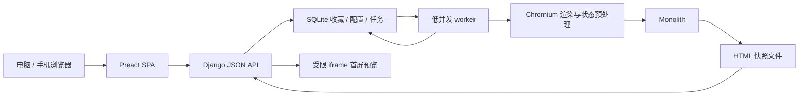

# 首版技术栈与职责

2026-10-09。本文件保留选型依据；应用已实现，实际版本和组合验证见 [实现记录](implementation-status.md)，设计总纲见 [完整技术方案](technical-plan.md)。

## 技术选型

| 层 | 选择 | 职责 |
| --- | --- | --- |
| 前端 | Preact、TypeScript、Vite SPA | 电脑/手机收藏管理界面，文件夹树、网格、标签、备注和搜索 |
| 前端样式与列表 | CSS Modules、标准 CSS、分页与会话内预览文档 | 响应式布局；当前分页完整入队，已完成文档跨导航保留 |
| 后端 | Python 3.13、Django 5.2 LTS 原生 JSON views | 收藏、文件夹、导入、刷新任务、快照访问 API |
| 认证 | Django auth/session、django-axes | 固定内部 owner 的单密码登录、会话与失败限流 |
| 数据 | 两份本地 SQLite 文件 | state 保存身份/会话/凭据；library 保存收藏、配置、任务与历史；无数据库服务 |
| 后台任务 | Django management command | 应用自有到期扫描、手动任务、低并发执行与恢复 |
| 快照 | Monolith CLI、HTML 文件目录 | 每站保存桌面/手机 HTML 快照的历史版本，替代 PNG 截图 |
| 动态页预处理 | Playwright Python、Chromium | 所有启用快照的网站默认先浏览器渲染，再交给 Monolith |
| 生产 HTTP 与静态资源 | Waitress、WhiteNoise | 同一 Web 服务提供 API 和前端构建资源；快照通过鉴权视图单独提供 |

前端为登录后的 SPA，业务 API 独立放在后端。采用 Preact 原生 hooks/state，不引入 React 兼容层、Redux、UI 框架或虚拟列表库。Vite 只用于开发和构建，生产前端为静态资源。按 [ADR-0009](adr/0009-preview-document-retention.md)，分页控制加载集合，桌面／手机并发为 2／1，已完成 iframe 文档保留到会话结束或对应数据失效。[Preact hooks](https://preactjs.com/guide/v11/hooks/)、[Vite 模板](https://vite.dev/guide/)、[IntersectionObserver](https://developer.mozilla.org/en-US/docs/Web/API/Intersection_Observer_API)

Django 5.2 为 LTS，认证、CSRF、ORM、迁移和 JSON 响应由同一个框架提供。API 用标准 views/JsonResponse 与 forms 校验，明确统一错误、分页和序列化，不添加 DRF。[Django 5.2](https://docs.djangoproject.com/en/5.2/releases/5.2/)、[JSON 响应](https://docs.djangoproject.com/en/5.2/ref/request-response/)、[forms](https://docs.djangoproject.com/en/5.2/ref/forms/api/)

SQLite 与低并发 worker 是针对个人单实例首版的选择，尚未验证容量。运行身份/会话与收藏业务分别放 state.sqlite3 和 library.sqlite3，HTML 放独立文件目录；网络归档不在数据库事务内执行，不增加 Huey、Redis 或数据库服务。[Django SQLite 边界](https://docs.djangoproject.com/en/5.2/ref/databases/)

Waitress 支持 Windows/Unix WSGI；WhiteNoise 提供前端已构建静态资源，不负责用户私有快照。快照放在静态目录之外，经 Django 鉴权视图读取。公网 HTTPS 和进程守护为部署配置。[Waitress](https://docs.pylonsproject.org/projects/waitress/en/stable/)、[WhiteNoise](https://whitenoise.readthedocs.io/en/stable/django.html)

## 执行路径

单站快照关闭时不生成归档任务，但保留已有快照，卡片仍可展示最近成功版本；没有任何历史时展示收藏信息。暂停自动刷新则保留快照并允许手动更新。定时和文件夹刷新共用任务创建逻辑，覆盖子文件夹并排除关闭快照的收藏。任务状态保存在数据库，供前端读取进度。

用户明确首版需要动态页面，目标与直接在浏览器看到的页面一致。Monolith 无 JS 引擎，因此启用快照的页面统一先经 Chromium 执行脚本、等待内容与资源，再取得渲染 DOM/状态并传给 Monolith。浏览器按需启动，批次复用一个实例、页面逐个处理，结束释放；不生成 PNG 快照。[Monolith](https://github.com/Y2Z/monolith)、[Playwright Page API](https://playwright.dev/docs/api/class-page#page-content)

用户选择分别保存桌面与手机快照。技术方案是在同一 Chromium 实例中建立隔离 context，分别使用固定桌面与手机设备配置，逐一处理并关闭页面/context；前端读取相应快照并按其采集视口重放后缩放。每份记录独立的文件、视口、更新时间与状态，不以一份成功代表两份成功。[Playwright 设备模拟](https://playwright.dev/python/docs/emulation)

历史模型追加每次成功保存记录，以网站、设备类型和采集时间定位版本；当前快照引用最新成功记录。文件不可因普通刷新覆盖旧版本，字节相同的文件可以复用存储引用。历史接口与版本读取沿用 owner 鉴权。历史默认全部保留，提供手动清理，不按时间或数量自动淘汰。删除收藏/文件夹时删除相关历史；清理文件必须先检查是否仍被其他快照记录引用，避免误删复用内容。

## 搜索界面与数据规则

搜索结果只列网站收藏。搜索框左侧固定为“搜索方式”下拉，内含多选复选框：域名、网址、网页名、标签、文件夹、备注；选中字段参与部分匹配，匹配标签或文件夹也返回其相关网站，不单列实体。默认综合搜索；首版不采集网页正文索引。后端根据字段白名单组织 ORM 查询，前端不引入独立搜索服务。

浏览器导入命中已有 URL 时跳过，保留当前记录、归属、配置与快照历史。收藏星标为独立按钮，不导航；点击卡片主体选中，详情在当前界面展开，通过独立按钮打开原网站。首版不提供卡片大小调节。

已确认默认全库搜索，可限定文件夹子树；标签多选任一命中；默认最近添加，并可按当前设备最近成功快照时间排序。支持多选移动、加减标签与删除。软件调用 AI API 生成分类方案，人工确认后执行，供应商与协议待选，见 ai-classification.md。整库备份恢复覆盖当前库，数据/历史一致性及任务暂停恢复另行实施设计。

page.content 不等于完整浏览器视觉状态。canvas/WebGL、视频、shadow DOM、iframe 子页面和脚本修改的样式等需保真预处理和实测；无条件删除内部 frames 不符合一致性目标。不能以 Monolith 成功退出代替视觉一致验收。[Playwright Python content](https://playwright.dev/python/docs/api/class-page#page-content)、[Canvas 状态导出边界](https://developer.mozilla.org/en-US/docs/Web/API/HTMLCanvasElement/toDataURL)

## 单密码登录

前端只提交密码；后端使用配置的固定 owner 调用 Django authenticate/login，沿用框架的密码哈希与数据库会话。登录及写 API 保留 Django CSRF，所有业务与快照接口明确检查 owner 会话，不因接口是 JSON 就豁免。[Django 认证](https://docs.djangoproject.com/en/5.2/topics/auth/default/)、[Django CSRF](https://docs.djangoproject.com/en/5.2/ref/csrf/)

django-axes 在 Django 认证流程中记录失败，必须传真实 request；配置有限冷却及 IP 相关锁定，避免仅按固定 owner 造成全站锁定。代理提供可信客户端 IP。[Axes 安装](https://django-axes.readthedocs.io/en/stable/2_installation.html)、[Axes 自定义认证](https://django-axes.readthedocs.io/en/stable/3_usage.html)

部署终端初始化与重置 owner 密码，不开放注册或公网首次初始化；该流程是当前技术方案。所有 API、快照、配置和任务资源需在后端鉴权。前后端代码和运行职责分离，浏览器可通过同一来源代理 /api 与快照接口访问，保留 CSRF 和安全 cookie。[Django CSRF](https://docs.djangoproject.com/en/5.2/ref/csrf/)

## HTML 预览与资源控制

快照在受限 iframe 中展示，不允许脚本和同源权限。快照响应 CSP 限制资源外连和执行；sandbox 本身不等于断网。网格缩放与裁剪显示采集视口的首屏，视区外隐藏而保留已加载文档，滚回或应用内导航返回时复用。对浏览器已执行后的视觉状态需在归档前固化，以避免预览再执行外站脚本。保真和内存均待验收。[iframe 文档](https://developer.mozilla.org/en-US/docs/Web/HTML/Reference/Elements/iframe)

归档 worker 设置总任务时限、并发和文件/进程资源预算，主页面、重定向及子资源只允许公开网络目标。最终文件检查不能代替下载期间的资源限制。新快照完成后追加版本并更新当前引用，旧成功文件保留；失败不改变当前成功引用。关闭功能或删除收藏后，迟到任务不能再生成不符合当前状态的内容。[Monolith 网络读取](https://github.com/Y2Z/monolith/blob/master/src/net.rs)

## 任务可靠性与 Windows

worker 为应用自有 management command，负责到期扫描、手动任务和状态恢复；Django 提供命令入口，本身不提供队列。首版单 worker、低并发执行，记录 queued/running/succeeded/failed 及执行 token/时限；条件 UPDATE queued→running 检查影响行数后抓取，SQLite 不依赖无效的 select_for_update。文件和数据库仍非原子，需要临时/版本文件与幂等恢复。[自定义命令](https://docs.djangoproject.com/en/5.2/howto/custom-management-commands/)、[条件更新与 SQLite 锁边界](https://docs.djangoproject.com/en/5.2/ref/models/querysets/)

Windows 和服务器均为 Web 服务加一个 worker；worker 显式管理 Chromium 和 Monolith 子进程的时限、结束与资源释放。没有为本项目另建通用分布式队列或追加常驻浏览器服务。

## 实施验收边界

- 真实 Chrome/Firefox HTML 导入：层级、中文、重复与原配置保留。
- 单密码登录：CSRF、实际限流、会话撤销、API 与快照鉴权。
- Monolith：静态页、动态 DOM、复杂样式；canvas、视频等浏览器状态不默认承诺保真。
- 电脑/手机：分页、按需挂载快速滚动和多 HTML 卡片内存，以及分别采集的两种布局。
- 快照历史：版本追加、停用仍可查看、各端独立时间与引用完整性。
- Windows/服务器：启停、强杀恢复、千条导入与刷新写竞争。

目前只核查文档与来源；没有安装栈、生成快照、执行渲染测试或部署。开始实现时锁定互相兼容的发布版本并复核安全补丁。
